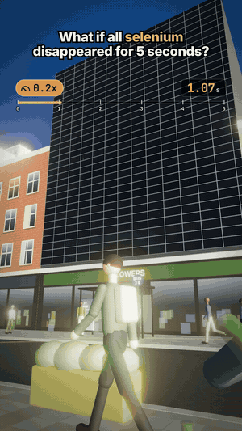

# 02 · What if all selenium disappeared for 5 seconds?

24 s · 1080×1920 (9:16) · 30 fps · stereo, −14 LUFS · source: [`sims/selenium/`](../../sims/selenium/) · video: [`media/sims/selenium.mp4`](../../media/sims/selenium.mp4)

A TikTok-format "what if" in first person. You sit at a café table on a city street at golden hour, your friend pouring water across from you. The speed pill slams from 1x to 0.1x and slowly climbs to 0.6x while a world clock counts the five seconds. A wave of vanishing atoms leaves from you and each beat shows one consequence:

| World time | What happens | Why it's true |
|---|---|---|
| 0.06 s | Bottles and glasses turn green | Selenium's pink decolorises soda-lime glass against the green of iron |
| 0.48 s | Red chairs, planters and the mug turn yellow | Cadmium red is Cd(S,Se); without Se it's CdS, cadmium yellow |
| 1.20 s | A solar facade drops to 0 W | CIGS is Cu(In,Ga)Se₂: half its atoms are selenium |
| 2.21 s | The billboard turns blue | Quantum-dot screens make red and green from a blue backlight with CdSe dots |
| 3.70 s | X-ray of your friend | Humans have 25 selenoproteins and about 15 mg of Se; the thyroid has the most per gram |
| 5.00 s | Selenium is back, speed snaps to 1x | |

## Prompt

> Make a video just like the What ifs trending on tiktok same recipe,: What if all selenium disappeared for 5 seconds with 0.1x slow Mo slowly going up at 0.6x with a person 3d view perspective and people, details and stuff 30fps

Then: "Go make it".

## Process

| Step | Time |
|---|---|
| Prompt → beat sheet, sim, sound, final capture | ~2 h, most of it frame capture in software GL |
| Model | Claude Opus 5.5 |

What the agent did on its own:

- **Two clocks.** Camera, captions and HUD run on real time. People, cars, pigeons, water and steam run on world time, the integral of the speed curve (`0.1 + 0.5·u^1.5`, so five world seconds take 16.7 real ones). Walkers are simulated once on that clock, so the ones near the screen can stop and stare at it.
- **The vanishing front as a shader.** Every selenium-bearing material is patched with one uniform radius: an orange edge where the front passes, the new colour, opacity or roughness behind it. The same radius drives the atom sparks and the facade's kW readout, so a big surface (the facade, the billboard) visibly sweeps instead of flipping.
- **Beats placed by the front.** The radius is keyed in real time so it reaches each subject just after the camera arrives: tabletop, chairs, facade, billboard.
- **Sound from the same timeline** (`sims/selenium/sound.py`): the street muffles and its chatter slows with the speed curve, then a slam, heartbeat, drone, a tick per world second, one sound per consequence and the return hit.
- **Four review passes** on contact sheets. Fixes: exposure and bloom blowing out the frame, a too-tight portrait FOV, the Se tile covering the friend's face, the glass beat aimed at an empty tabletop, an awning blocking the billboard, skin glow lingering on anyone near the slow front, callouts colliding with captions, a white car disappearing into the haze.

## Data

Chemistry on screen is textbook. Everything else is invented: the street, the people, the shops, the juice ad, the facade's 41.8 kW.
