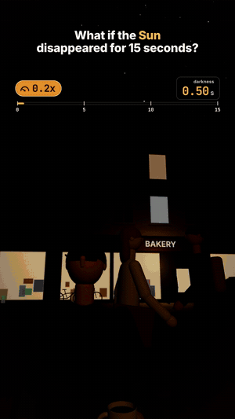

# 03 · What if the Sun disappeared for 15 seconds?

38 s · 1080×1920 (9:16) · 30 fps · stereo, −14 LUFS · source: [`sims/nosun/`](../../sims/nosun/) · video: [`media/sims/nosun.mp4`](../../media/sims/nosun.mp4)

The follow-up to [02](../02-selenium-what-if/), same café table, same recipe, with the real physics as the hook: sunlight and the Sun's gravity both travel at the speed of light, so when the Sun vanishes nothing on Earth changes for 8 min 19 s. The speed pill fast-forwards through the wait (peaking at 225x) while a space-view inset shows the 15-light-second gap in the light flying toward Earth. Then it lands, the pill slams to 0.1x and climbs to 1.3x across the 15 seconds of night.

| On the clock | What happens | Why it's true |
|---|---|---|
| 0:00 | The Sun vanishes. It's still in the sky | The light you see left it 8 min 19 s ago |
| 8:19 · 0.00 s | The sky goes black | Daylight is sunlight scattered by the air; it stops with the sunlight |
| 1.28 s | The Moon goes dark | Moonlight is reflected sunlight, 1.28 light-seconds late |
| 2.4 s | The brightest stars and Jupiter appear | Jupiter's light reaches us 76 to 96 min after the Sun's would go out there |
| 4.8 s | Phone torches, auto headlights; solar panels at 0 W | |
| 7.6 s | Earth flies straight | No pull for 15 s: ½ · 5.93 mm/s² · (15 s)² = 67 cm off the orbit |
| 10.6 s | Your eyes are still adjusting | Full dark adaptation takes 20 to 30 minutes |
| 15.00 s | The Sun is back, blinding | |

## Prompt

After 02, in the same session:

> Now what if there was no sun for 15 seconds

## Process

| Step | Time |
|---|---|
| Prompt → sim, sound, final capture | ~1.5 h, most of it frame capture in software GL |
| Model | Claude Opus 5.5 |

What the agent did on its own:

- **Kept the premise true.** Instead of switching the lights off at once, it made the 8 min 19 s light delay the twist and built the edit around it: a fast-forward, then the slow motion the format wants.
- **Three clocks.** Real time for the camera and overlay; world time since the vanish for people, cars and the Sun's drift across the sky (2° during the wait); dark time for the beats. The fast-forward's peak speed is solved so the clock lands on 8:19 exactly when the darkness arrives.
- **Night as lighting, not a filter.** The sky fades under a black dome with stars, the Moon is lit from the Sun's direction and switches off 1.28 s late, shop windows and rooms get an emissive map, the café and shop interiors become light pools, cars brake and switch on headlights, people stop, look up and pull out phone torches. Exposure follows the eye (pupils open over a few seconds), and bloom follows the exposure so night lights glow without blowing out the day.
- **Explainer insets drawn per frame:** the light gap between Sun and Earth, and Earth's straight path off its orbit with the live drift in cm.
- **Three review passes.** Fixes: a white-out when looking into the Sun (now dips exposure and bloom like a phone camera), headlight and torch cones filling the frame, a Moon too small to read on a phone, a billboard blooming into glare after dark adaptation, captions orphaning "19 s".

## Data

Physics on screen is textbook; the street, the people and the shops are invented. The Moon is a quarter Moon, exactly 90° from the Sun, so the gap reaches it at the same moment as Earth and its 1.28 s delay is only the trip back to us.
