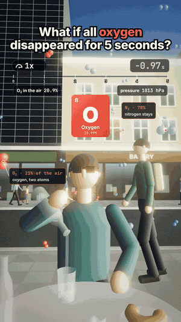

# 04 · What if all oxygen disappeared for 5 seconds?

24 s · 1080×1920 (9:16) · 30 fps · stereo, −14 LUFS · source: [`sims/oxygen/`](../../sims/oxygen/) · video: [`media/sims/oxygen.mp4`](../../media/sims/oxygen.mp4)

The viral one, redone with only claims that hold up. Same café table and recipe as [02](../02-selenium-what-if/): 1x, slam to 0.1x, climb to 0.6x across the five world seconds. The hook shows the air as molecules, blue N₂ and red O₂, and the red ones pop out of existence.

**The assumption, stated:** the O₂ and ozone in the air vanish. If the oxygen bound in water, rock and people vanished too, there would be no survivors and nothing to film: water would become high-pressure hydrogen and a body is about 65% oxygen by mass.

| Beat | What happens | Why it's true |
|---|---|---|
| 0.00 s | Air pressure drops 21%, ears pop | O₂ is 20.9% of dry air: 1013 → 801 hPa, the standard-atmosphere pressure near 2 km |
| 0.00 s | Candles and the patio heater go out, smoke rises in slow motion | Combustion needs an oxidiser |
| 0.00 s | Petrol engines stall, cars coast with brake lights; the electric car drives on | Internal combustion needs air's oxygen, batteries don't |
| | The sky stays blue, a little darker | Rayleigh scattering is mostly nitrogen. The viral "sky goes black" is wrong |
| | The ozone layer is gone: UV-C reaches the ground (shown in violet) | Ozone and O₂ absorb all solar UV-C |
| 2.6 s | The billboard and traffic lights die | Gas and coal plants lose their flames and trip; restarting takes hours |
| 4.1 s | Nobody passes out | Time of useful consciousness at zero oxygen is about 10 s (FAA, above 15 km) |
| 5.00 s | Oxygen is back. The candles and the power stay out | Nothing relights by itself |

## Prompt

After 02 and 03, in the same session:

> Now what if all oxygen disappeared for 5 seconds with real sciences and facts

## Process

| Step | Time |
|---|---|
| Prompt → sim, sound, final capture | ~1 h, half of it frame capture in software GL |
| Model | Claude Opus 5.5 |

What the agent did on its own:

- **Picked the survivable reading and said so on screen and here,** instead of the viral version's mix of true and false claims (concrete crumbling, the sky going black, eardrums bursting).
- **Built it from parts of 02 and 03**: the golden-hour street, the slow-motion clock, the people and the water pour from 02; the simpler billboard, the street's south end and the facade emissive maps from 03. New: instanced molecules, candle flames and smoke, a patio heater that cools, cars that coast to a stop, an exhaust plume, UV streaks, a grid that flickers and dies.
- **Readouts that move**: O₂ 20.9% → 0.0% and 1013 → 801 hPa under the clock, back at 5 s.
- **Two review passes.** Fixes: a patio heater planted in the middle of the shot (moved behind the neighbours' table so heater and candle share a frame), molecules too close to the lens, an ear touch too slow to read, two callouts on top of each other, captions orphaning a word. The first mix came out at −21 LUFS because the ear pop stacked on the slam's impact; trimmed and the bed raised to land on −14.

## Data

Physics, chemistry and physiology on screen are textbook; the street, people and shops are invented.
