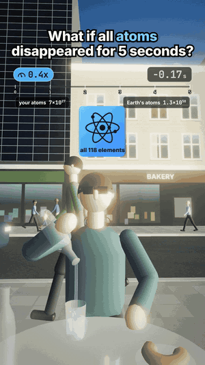

# 05 · What if all atoms disappeared for 5 seconds?

27 s · 1080×1920 (9:16) · 30 fps · stereo, −14 LUFS · source: [`sims/atoms/`](../../sims/atoms/) · video: [`media/sims/atoms.mp4`](../../media/sims/atoms.mp4)

The same café table and recipe as [02](../02-selenium-what-if/) (1x, slam to 0.1x, climb to 0.6x). Every atom goes, including the street, the air, Earth, the Sun and you; the camera stays as a ghost. The café dissolves through glowing holes into a starfield, and the video lists what is left once nothing made of atoms is.

| World time | What happens | Why it's true |
|---|---|---|
| 0.00 s | Every atom is gone, and so is all sound | Sound needs air |
| 0.04 s | Stars under your feet | Light crosses Earth's 12,742 km in 0.042 s |
| | The Sun still shines | 8 min 19 s of its light is already on the way |
| 1.28 s | The Moon vanishes | Its last reflected light was 1.28 light-seconds out |
| | What's left: light in flight, neutrinos, the Big Bang's glow, dark matter | Solar neutrinos ~6.5×10¹⁰ per cm² per s; CMB ~411 photons per cm³; local dark matter 0.3–0.4 GeV/cm³, i.e. 0.6–0.8 kg in Earth's volume |
| | Nobody will remember | No atoms, no brains, no memories |
| 5.00 s | Everything is back, nobody noticed | |
| +8 min 19 s | The Sun blinks off for 5 s | Its light carries a 5-second gap on the way |

Counters under the clock: your atoms (~7×10²⁷ for 70 kg) and Earth's (~1.3×10⁵⁰), both to 0 and back.

## Prompt

After 02, 03 and 04, in the same session:

> Now what if all atoms disappeared for 5 seconds with real science and facts

## Process

| Step | Time |
|---|---|
| Prompt → sim, sound, final capture | ~1 h, half of it frame capture in software GL |
| Model | Claude Opus 5.5 |

What the agent did on its own:

- **Found the true story in an impossible premise:** most of what you'd "see" with no atoms is light that is already travelling, so the Sun, the Moon and the stars keep appearing on their own light-delay schedules, and the end of the video is the Sun's 5-second gap on its way.
- **One dissolve shader for the whole world:** every standard material in the scene is patched with world-space noise and a glowing edge driven by a single uniform, so the street, the people, the table and the pavement go (and come back) together. Sparks are sampled off every static surface.
- **Space built for the void:** a black dome over the sky, 4,200 stars on the full sphere with a Milky Way band, a hard white unscattered Sun, a quarter Moon (90° from the Sun, so 1.28 s is exactly its light time), neutrino streaks, a "what's left" panel and a space-view inset of the light gap.
- **Sound follows the physics:** the street cuts to silence when the air goes; only score plays in the void.
- **Two review passes.** Fixes: the dissolve whiting out the frame (edge glow, sparks and flash stacked), Milky Way glow reading as grey blobs, callouts crowding the panel, a caption orphaning a word.

## Data

Physics on screen is textbook; the street, people and shops are invented. "Ghost camera" is the one liberty: with every atom gone there is nobody to look.
