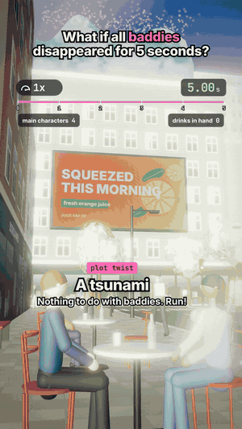

# 06 · What if all baddies disappeared for 5 seconds?

29 s · 1080×1920 (9:16) · 30 fps · stereo, −14 LUFS · source: [`sims/baddies/`](../../sims/baddies/) · video: [`media/sims/baddies.mp4`](../../media/sims/baddies.mp4)

A joke one, on purpose: "baddies" in the TikTok sense, the street's stylish main characters (your friend across the table included), vanish in a glam sparkle. The jokes are never at their expense, and the real science is in what they leave behind, because gravity takes over.

| World time | What happens | The physics |
|---|---|---|
| 0.00 s | Four baddies vanish, their things stay where they were | |
| 0.23 s | Your friend's bottle hits the table and topples | 25 cm of free fall: √(2h/g) = 0.23 s |
| 0.50 s | An iced coffee hits the pavement, ice everywhere | 1.2 m of free fall: 0.50 s, and the coffee stays in the cup until impact |
| | A ring light keeps lighting nobody; the livestream keeps rolling | |
| 5.00 s | They respawn on the same spot; their drinks don't | |
| plot twist | A tsunami comes over the rooftops, people stop and stare, it hits the camera | Fiction, and the caption says so. One real tip on screen: if the sea suddenly pulls back, head for high ground |

The fall times on screen are computed from the props' real heights in the scene, and the coffee callout reads its numbers from the simulation.

## Prompt

After 02 to 05, in the same session:

> Now what if baddies disappeared for 5 seconds with real science and then add a tsunami in the end

The agent asked what "baddies" meant (bacteria, criminals, batteries or the slang) and how the tsunami should relate; the answers were "the TikTok slang" and "a fun twist ending".

## Process

| Step | Time |
|---|---|
| Prompt → questions → sim, sound, final capture | ~1 h, half of it frame capture in software GL |
| Model | Claude Opus 5.5 |

What the agent did on its own:

- **Kept the joke kind:** baddies of several genders, celebrated as the street's main characters; the humour is in physics and timing.
- **Props as free bodies:** each held object takes its position and velocity from the pose at W = 0 and falls with g = 9.81 m/s², then splashes, tips or slides. The splash, ice cubes and puddles are simulated from the same landing time.
- **A dissolve only for the baddies:** their materials are their own, so one shader uniform dissolves them (and brings them back) without touching anyone else.
- **The tsunami:** a curling cross-section swept across the street and animated per frame, foam keyed to the crest's real position on the profile, spray thrown off the lip, people reacting, then an underwater overlay for the end card.
- **Two review passes.** Fixes: the coffee callout reading 0.8 m because the hand was lowered one frame too early (the physics label disagreed with the caption), a car parked in the ring-light shot, a ring light seen edge-on, a wave hidden behind the rooftops and then all foam.

## Data

The street, people and brands are invented. The tsunami is not caused by anything in the video.
