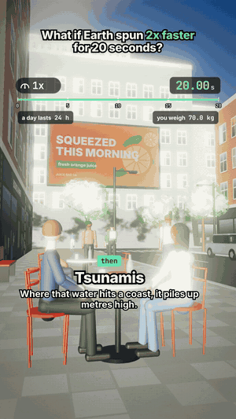

# 07 · What if Earth spun 2x faster for 20 seconds?

29.5 s · 1080×1920 (9:16) · 30 fps · stereo, −14 LUFS · source: [`sims/spin/`](../../sims/spin/) · video: [`media/sims/spin.mp4`](../../media/sims/spin.mp4)

Same café table, a city at 45° north with the sea beyond the north end of the street. The speed pill slams to 0.5x and climbs to 2x, so 20 world seconds play in 17. This time the tsunami at the end is real physics, not a gag.

**The assumption, stated:** air, oceans and people spin up with the ground. If only the ground did, the air would hit everything at 1,200 km/h (the surface speed at 45°).

| World time | What happens | The physics at 45° |
|---|---|---|
| 0 s | Earth spins 2x faster | Centrifugal acceleration goes up 4x |
| | You get 0.5% lighter: 70 kg reads 69.6 kg | Extra 3ω²R cos²φ = 0.051 m/s² upward |
| | A day lasts 12 hours | The Sun still only moves 0.0084° per second |
| | The oceans start sliding toward the equator | Extra 3ω²R cosφ sinφ = 0.051 m/s² toward the equator; the old sea surface is no longer level |
| | Your friend's water tilts 0.30° | Same push, in a glass |
| | So does the air: a breeze toward the equator | Same push, up to 1 m/s |
| | Earth gains 6.4 × 10²⁹ J | 4x the spin energy, about 28 minutes of the Sun's total output |
| 20 s | Back to normal, but the oceans keep moving at 1.02 m/s | Momentum; 10 m of drift |
| after | Tsunamis where that water meets a pole-facing coast | A 1 m/s current stopped at a coast 10 to 200 m deep piles up 2 to 9 m (2u√(H/g)) |

## Prompt

After 02 to 06, in the same session:

> Now what if the earth spun 2x more per second disappeared for 20 seconds

then

> Add tsunami at the end aswell

Read as "spun 2x faster for 20 seconds" (two full turns per second would tear Earth apart at once).

## Process

| Step | Time |
|---|---|
| Prompt → sim, sound, final capture | ~1 h, half of it frame capture in software GL |
| Model | Claude Opus 5.5 |

What the agent did on its own:

- **Worked the physics first** and found a real mechanism for the tsunami the prompt asked for: a global body force on the oceans for 20 s, then momentum into coastlines.
- **Readouts that follow the clock:** day length and your weight in the HUD, a globe inset spinning twice as fast with ocean-current arrows and a live m/s value that keeps reading 1.02 after the spin returns to normal.
- **Small true things you can see:** the café flag lifting south as the breeze builds, steam and trees leaning the same way, dust drifting.
- **A realistic bore, not a fantasy wall:** about 6.5 m of muddy, foaming water coming up the street, people turning to look, then under water for the end card.
- **Two review passes.** Fixes: the tsunami shots aimed too high (the bore read small and sat behind the neighbours).

## Data

Physics on screen is textbook; the street, people and shops are invented.
