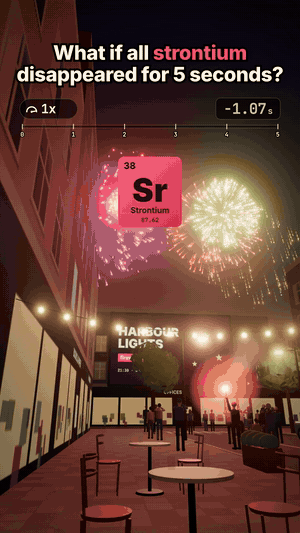

# 08 · What if all strontium disappeared for 5 seconds?

24 s · 1080×1920 (9:16) · 30 fps · stereo, −14 LUFS · source: [`sims/strontium/`](../../sims/strontium/) · video: [`media/sims/strontium.mp4`](../../media/sims/strontium.mp4)

The same café table, on a fireworks night: the street is closed, a crowd watches the show over the bay, a fan holds up a red road flare. The speed pill slams to 0.1x and climbs to 0.6x while strontium is gone, everywhere at once.

| World time | What happens | The science |
|---|---|---|
| 0 s | Red fireworks go pale orange | Red stars are coloured by strontium salts: the red is light from SrCl and SrOH. Without it you see the hot particles and the sodium yellow. |
| | Crimson sparks stream off them, the street, the crowd | The strontium leaving: rock and concrete are about 0.04% strontium, people carry some in their bones |
| | The red flare burns orange | Road flares get their red from strontium nitrate |
| | Purple fireworks come out blue | Purple is strontium red plus copper blue |
| | Your bones lose 0.3 g | An adult holds about 0.32 g of strontium, 99% of it in bone, where it sits in place of calcium |
| | The best clocks on Earth stop | Strontium optical lattice clocks count the 429,228,004,229,873 Hz transition of strontium-87; the best are uncertain by about 1 part in 10¹⁸ (under 1 s in the age of the universe). Your phone keeps time on a 32,768 Hz quartz crystal. |
| | The oceans lose 11 trillion tonnes | 7.9 mg per kg of seawater, 1.37 × 10²¹ kg of ocean |
| 5 s | Strontium is back | The stars still burning turn red again |

The sound runs on the same world clock: every shell's boom reaches you about 0.7 s after its flash, the time sound takes to cross 250 m of air.

## Prompt

After 02 to 07, in the same session:

> What if strontium disappears for 5 seconds?

## Process

| Step | Time |
|---|---|
| Prompt → sim, sound, final capture | ~1 h, half of it frame capture in software GL |

What the agent did on its own:

- **Picked a night with fireworks,** because that is where strontium is visible: it is the red in red fireworks and road flares. Every burst is precomputed (stars with drag, gravity, wind and trails) and coloured from one switch, so a red shell that bursts while strontium is gone comes out pale, and the ones still burning at 5 s turn red again in shot.
- **Only true claims on screen,** and the counter-intuitive ones kept: the purple stars that turn blue, the clocks that stop while your phone's quartz keeps ticking.
- **An x-ray of your friend** with a skeleton built into the rig, and two inset panels (a lattice clock with its atom cloud gone, the oceans).
- **Three review passes.** Fixes: the skyline and the end of the street hid the show (lowered, the show moved closer), string lights crossed the sky, the purple burst sat behind a building, the phone's lock screen was sideways.

## Data

Science on screen is textbook; the street, people, festival and brands are invented.
