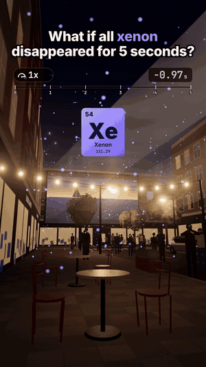

# 09 · What if all xenon disappeared for 5 seconds?

29 s · 1080×1920 (9:16) · 30 fps · stereo, −14 LUFS · source: [`sims/xenon/`](../../sims/xenon/) · video: [`media/sims/xenon.mp4`](../../media/sims/xenon.mp4)

The same café table, on an open-air cinema night: a film on a big screen at the end of the closed street, a projector on a tower behind you, an event photographer working the crowd. The speed pill slams to 0.1x and climbs to 0.6x while xenon is gone. Then, because the series has a running joke, a tsunami.

| World time | What happens | The science |
|---|---|---|
| 0 s | The film and its beam go black | Cinema projector lamps are an arc through xenon gas: no gas, no arc. The sound keeps playing, because speakers don't need xenon. |
| | Lavender sparks leave the air | The xenon in it, drawn huge and few: really 1 in every 11.5 million air molecules |
| | The photographer's flash fires nothing | A flash tube is a spark through xenon. The phone next to them flashes fine: an LED. |
| | The air is 2 billion tonnes lighter | Xenon is 87 of every billion air molecules, and heavy ones: 2 × 10¹² kg. Pressure drops 0.009 Pa, the same as raising your head 0.7 mm. |
| | Ion engines in space shut off | Xenon is the propellant; NASA's Psyche launched with 1,085 kg of it |
| | A dark matter detector empties | LZ holds 10 tonnes of liquid xenon, 1.5 km under South Dakota |
| | Nothing else changes | Xenon is a noble gas and barely reacts with anything |
| 5 s | Xenon is back | The projector's lamp can be struck again |
| after | A tsunami | Nothing to do with xenon, and the caption says so |

## Prompt

After 02 to 08, in the same session:

> Now what if Xenon disappeared for 5 seconds with a ofc a tsunami at the end

## Process

| Step | Time |
|---|---|
| Prompt → sim, sound, final capture | ~1 h, half of it frame capture in software GL |

What the agent did on its own:

- **Found where xenon shows:** almost nowhere, which is the point. It is in arc lamps and flash tubes, so the night is built around light: a projector beam through the haze, a film on the screen, flashes popping in the crowd.
- **A contrast you can see:** the same beat shows the xenon flash firing nothing and a phone's LED flash going off next to it.
- **The anticlimax as a fact:** a live air-pressure readout that drops from 1013.25000 to 1013.24991 hPa.
- **Kept the joke honest:** the tsunami from 06 relit for night, with a caption that says it has nothing to do with xenon, and a real tsunami tip on screen.
- **Two review passes.** Fixes: the beam and the atoms too faint, the photographer a black silhouette (a café light added), the night wave reading as a pale wall.

## Data

Science on screen is textbook; the street, people, festival, film and brands are invented.
