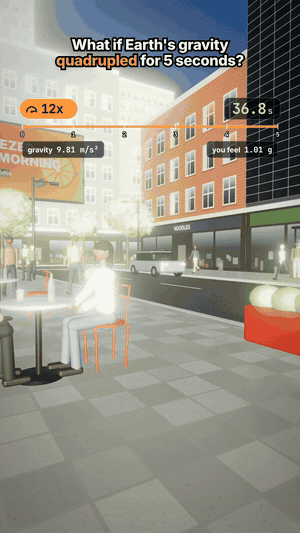

# 10 · What if Earth's gravity quadrupled for 5 seconds?

32 s · 1080×1920 (9:16) · 30 fps · stereo, −14 LUFS · source: [`sims/gravity/`](../../sims/gravity/) · video: [`media/sims/gravity.mp4`](../../media/sims/gravity.mp4)

The café table again, on a sunny afternoon. The speed pill slams to 0.1x and climbs to 0.6x while gravity is 4x. Gravity then goes back to normal, but the world doesn't: the video stays on the after-effects.

**The physics twist.** If every bit of Earth weighs 4x, the rock under you is still held up only by the pressure that held 1x, so the ground starts falling toward the core at 3 g, and you fall with it. Locally nothing feels different (Einstein's lift): your weight, the water pouring, all the same. The damage comes from what the whole planet does.

| World time | What happens | The physics |
|---|---|---|
| 0 s | Gravity 9.81 → 39.2 m/s², and you feel 1.00 g | You and the ground both fall at an extra 3 g, so the push between you is unchanged |
| | The water still pours normally | Bottle, water and glass all fall together |
| | The street sinks 370 m toward the core | ½ × 29.4 m/s² × (5 s)² = 368 m; the readout runs live |
| | Satellites start falling | The ISS is too slow for 4x gravity: 130 m/s toward Earth lowers its orbit's low point by 115 km |
| | The rock is squeezed | A shrinking planet presses every continent from the sides |
| 5 s | Gravity is back to normal, Earth isn't | The surface is still moving inward at 147 m/s (530 km/h) |
| +30 s | Every fault breaks: an earthquake on the street | The planet takes minutes to brake, squeezing the crust far past what rock can take; glass and cornices come down, a rift opens across the road, the billboard tears loose |
| for weeks | Earth rings like a bell | Its breathing mode (0S0) has a 20.5-minute period and rings for weeks; 147 m/s means a swing of about 29 km |

## Prompt

After 02 to 09, in the same session:

> What if our gravity multiples by 4 for 5 seconds "after it's finished don't make it turn back to normal make it a after effect*

## Process

| Step | Time |
|---|---|
| Prompt → sim, sound, final capture | ~1 h 15 min, half of it frame capture in software GL |

What the agent did on its own:

- **Worked the physics before drawing anything,** and found that the honest answer is stranger than the obvious one: for 5 s nobody on the street feels a thing. The after-effects the prompt asked for are where the damage really is.
- **Live readouts on the same clock:** gravity, what you feel (1.00 g during, 1.01 g as the planet brakes), how far the street has fallen and how fast, the ISS orbit's low point.
- **A fast-forward of 30 s** after gravity is back, labelled on screen, to reach the earthquake.
- **After-effects that stay:** fallen glasses and cups, glass and cornice chunks on the pavement, a rift across the road, the billboard hanging off its bolts, dust in the air, people still crouched.
- **Three review passes.** Fixes: the title on three lines, dust haze washing out the frame, the rupture invisible at a grazing angle (made into a heaved step and moved into view).

## Data

Physics on screen is worked from textbook values (the 0S0 period and Q, the ISS's orbit); the street, people and brands are invented.
