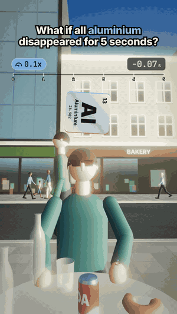

# 11 · What if all aluminium disappeared for 5 seconds?

30.5 s · 1080×1920 (9:16) · 30 fps · stereo, −14 LUFS · source: [`sims/aluminium/`](../../sims/aluminium/) · video: [`media/sims/aluminium.mp4`](../../media/sims/aluminium.mp4)

The café table on a sunny afternoon. The speed pill slams to 0.1x and climbs to 0.6x while aluminium is gone. When it comes back, it comes back exactly where it was, and nothing that already fell gets undone. Six minutes later, a tsunami.

| World time | What happens | The science |
|---|---|---|
| 0 s | The friend's can vanishes and the cola keeps its shape for an instant | The top of a 12 cm column falls freely: it is down in √(2 × 0.118 / 9.81) = 0.15 s, then splashes and runs off the table |
| | A glass office wall falls out, pane by pane | Its frames are aluminium; glass from 20 m up lands in 2 s and shatters on the pavement |
| | A passing car sinks onto its brakes and grinds to a stop in sparks | Alloy wheels are aluminium; steel brake discs on asphalt (μ ≈ 0.55) stop it from 9 m/s in 1.7 s |
| | The sapphire leaves the friend's ring | A sapphire is corundum, aluminium oxide; so is a ruby. The gold setting stays |
| | The pavement cracks | Earth's crust is 8.1% aluminium, the most common metal on Earth, locked into rock and concrete |
| | The power goes out | Most long-distance power lines are aluminium; the grid trips and stays down |
| 5 s | Aluminium is back, right where it was | An empty can on a soaked table, empty window frames, and four alloy wheels on the road 7 m behind the car |
| +6 min | A tsunami comes up the street | Weakened seabed slopes slide, and undersea slides make tsunamis |

## Prompt

After 02 to 10, in the same session:

> What if all Almunium Disappeared for 5 seconds with a tsunami at the end and keep the after effect

## Process

| Step | Time |
|---|---|
| Prompt → sim, sound, final capture | ~1 h 15 min, half of it frame capture in software GL |

What the agent did on its own:

- **Made "keep the after effect" a rule of the world:** everything that returns returns to where it was at 0 s, so the can is back empty, the window frames are back without glass, and the car's wheels land on the road where the car used to be.
- **Real timings for everything that falls:** the cola column, panes from each floor, a car braking on its discs.
- **Gave the tsunami a cause** instead of a gag, and kept the claim general: undersea slides do make tsunamis.
- **Two review passes.** Fixes: the car hidden behind a planter, the ring hidden under the friend's hand, a neighbour standing exactly in line with the wheels.

## Data

Science on screen is textbook; the street, people and brands are invented.
